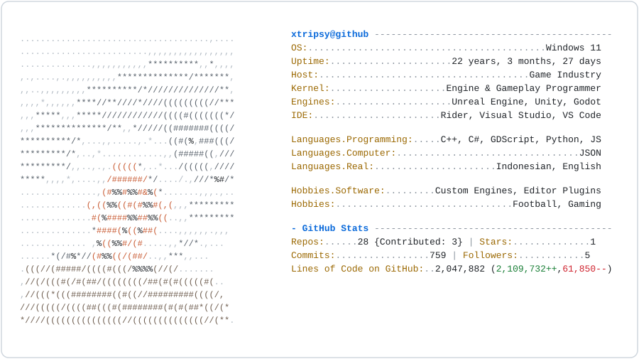

<pre>
xtripsy@github:~$ whoami --verbose
.
├── Name       — Aditya Muhammad Ifanrus (XTripsy)
├── Role       — Engine &amp; Gameplay Programmer
├── Stack      — C++, C# | Unreal Engine, Unity, OpenGL
├── Focus      — Data-oriented systems, modular gameplay frameworks &amp; optimization
└── Connect    — <a href="cv.md"><b>CV</b></a> | <a href="https://www.linkedin.com/in/aditya-muhammad-ifanrus-a55948332">LinkedIn</a> | <a href="https://aditya-muhammad-ifanrus.itch.io/">Itch.io</a> | <a href="https://github.com/XTripsy">GitHub</a> | <a href="mailto:epoch.aditya.flux@gmail.com">Email</a> | Discord: itsadit
</pre>

  <picture>
    <source media="(prefers-color-scheme: dark)" srcset="dark_mode.svg">
    
  </picture>

<pre>
xtripsy@github:~/portfolio$ tree -L 2
.
├── tools/
│   └── <a href="tools/fluxPrime.md"><b>fluxPrime/</b></a>          [Unreal C++]  Engine Plugin       — DOD/SoA crowd simulation &amp; VAT/ISMC
│
└── games/
    ├── <a href="games/andalas/andalas.md"><b>Andalas/</b></a>            [Unreal C++]  Commercial Intern   — UE5 C++ migration, State Tree &amp; GAS
    ├── <a href="games/triple-shift/tripleshift.md"><b>Triple-Shift/</b></a>       [OpenGL C++]  Engine Programmer   — Custom 2D ECS engine &amp; JSON levels
    ├── <a href="games/neo-strife/neostrife.md"><b>Neo-Strife/</b></a>         [Unreal C++]  Solo Developer      — 100% pure C++ FPS &amp; card CC system
    ├── <a href="games/indekos/indekos.md"><b>Indekos/</b></a>            [Unity C#]    Commercial Lead Dev — Scene-per-location &amp; quest spawner
    └── archive/
        ├── <a href="games/fish-and-fish/fish-and-fish.md"><b>Fish-and-Fish/</b></a>  [OpenGL C++]  Engine &amp; Core Loop  — Custom OpenGL loop, ECS &amp; API-ready state
        ├── <a href="games/dgreek-cook/dgreekcook.md"><b>Dgreek-Cook/</b></a>    [Unity C#]    Gameplay Systems    — Local co-op FSM &amp; Unreal rebuild
        ├── <a href="games/carnifall/carnifall.md"><b>Carnifall/</b></a>      [Unity C#]    Systems &amp; Gameplay  — Unified FSM, turrets &amp; pooling
        ├── <a href="games/duck/duck.md"><b>Duck/</b></a>           [Unreal BP]   Foundational (UE)   — 3D platformer, Behavior Tree &amp; art
        └── <a href="games/criminal/criminal.md"><b>Criminal/</b></a>       [Unity C#]    Foundational (SMK)  — 18+ modular weapons, NavMesh &amp; IK
</pre>
