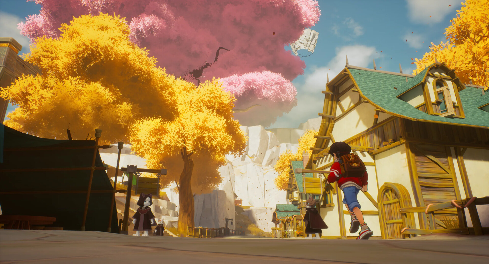

[← cd ~/portfolio](../../README.md)

# `$ cat ~/games/andalas.md`

```yaml
Project          : Andalas: Realms of Eternal Lights
Status           : Commercial Release (Upcoming on Steam)
Context          : Internship / Professional Work (@BusyBeaverStudio)
Platform         : PC (Windows)
Engine           : Unreal Engine 5
Language         : C++ & Blueprints (GAS, State Tree, Data Assets)
Role             : Game Programmer (Gameplay Systems & Character Behavior)
Version Control  : Git
Timeline         : January 2026 – June 2026
```

### Visual Showcase
<!-- GANTI DENGAN SCREENSHOT / GIF RESMI DARI HALAMAN STEAM ANDALAS -->


```yaml
Showcase      : 3D narrative action-adventure built in Unreal Engine 5 with C++ systems & GAS
Highlights    : Blueprint-to-C++ migration, State Tree + GAS companion AI, data-driven UI & automated QA
```

---

### Architecture & Engineering Contributions
```yaml
C++ Migration  : Migrated core Companion Handler, class hierarchies & State Tree Tasks from Blueprint to C++
AI & Behavior  : Integrated Unreal State Tree (decision-making) with Gameplay Ability System (action execution)
Data-Driven    : Built Data Asset schemas & GameplayTag-driven UI/projectile bindings for designer workflows
Gameplay Loop  : Extended modular Challenge System (Controller, Manager, Objective, State) for Vertical Slice
Automated QA   : Authored C++ Unit Tests & Blueprint Functional Tests integrated into daily server builds
```

<details>
<summary><b>📂 Inspect High-Level System Architecture</b></summary>

```text
├───Character Behavior & AI (C++)
│   ├───CompanionHandler (Centralized state, lifecycle & event broadcasting)
│   ├───BaseCompanion -> Derived Companions (OOP inheritance & virtual overrides)
│   └───StateTree + GAS Bridge (C++ State Tree Tasks -> Gameplay Ability activation)
├───Data-Driven Gameplay Systems (C++ & Data Assets)
│   ├───ChallengeSystem (ChallengeController, Manager, Objective, WorldObject, State)
│   ├───CraftingSystem (DataAsset recipes, GameplayTag identity & dynamic UI binding)
│   └───ProjectileSystem (Data-driven projectile & dynamic impact VFX configuration)
└───Quality Assurance & CI Pipeline
    ├───Automated Unit Tests (C++ logic & GAS validation via Rider)
    └───Functional Tests (Blueprint gameplay & AI scenario verification on daily builds)
```

</details>

---

### Technical Challenges & Solutions
```yaml
Challenge     : Growing Blueprint complexity in character behaviors and risk of regressions across daily builds
Solution      : Migrated core systems to C++, decoupled AI decisions (State Tree) from actions (GAS) & added tests
Result        : Cleaner inheritance hierarchy, data-driven designer workflows & automated daily build verification
```

---

### Links & Media
<pre>
Steam Page     : <a href="https://store.steampowered.com/app/3367720/ANDALAS_Realms_of_Eternal_Lights/">Steam Store (Andalas: Realms of Eternal Lights)</a>
Studio         : Busy Beaver Studio (PT. Berang Berang Sibuk)
</pre>

<br>

[← cd ~/portfolio](../../README.md)
