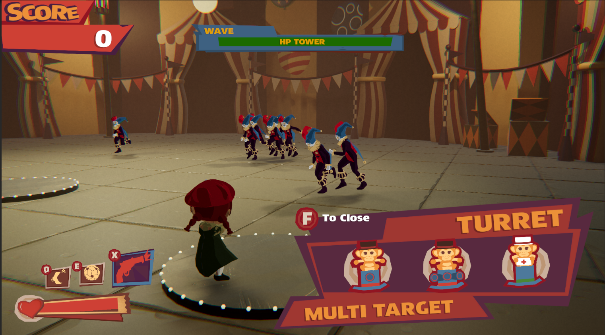
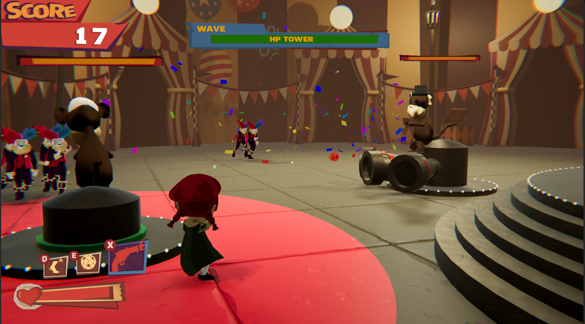
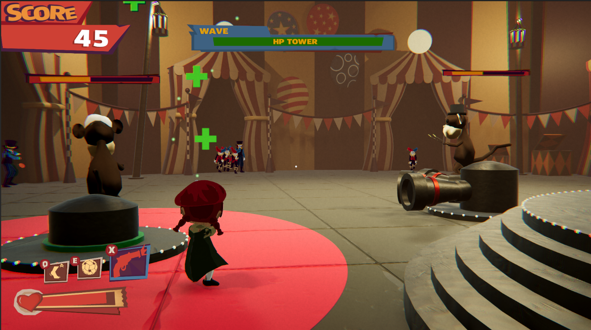

[← cd ~/portfolio](../README.md)

# `$ cat ~/games/carnifall.md`

```yaml
Project          : Carnifall
Status           : Prototype
Engine           : Unity
Language         : C#
Role             : Systems & Gameplay Programmer
Version Control  : Git
Timeline         : August 2025 - August 2025
```

### Visual Showcase


```yaml
Showcase      : Third-person wave-based arena combat
Highlights    : Unified state management, turret placement, object-pooled projectiles
```

<details>
<summary><b>📸 View Screenshot Gallery (3)</b></summary>
<br>





</details>

---

### Architecture & Gameplay Systems
```yaml
Core Patterns : Unified State Manager (Singleton + State), Observer, Factory, Decorator
Data & Memory : ScriptableObject Data Architecture & custom ObjectPoolManager
AI & Entities : Modular FSM for Enemies (Melee, Ranged, Boss) & Turrets (Single, Multi, Heal)
Player & TPS  : Decoupled TPSCamera, InputManager, PlayerSkills, Fire & Grenade systems
```

<details>
<summary><b>📂 Inspect Script Architecture (<code>$ tree Assets/Scripts</code>)</b></summary>

```text
├───Controls
│       Controller.cs
├───Core
│   ├───Data (ScriptableObjects: Audio, Enemy, Player, Tower, Turrets, Projectile)
│   ├───decorator
│   ├───Entities
│   │   ├───AI (BossAI, EnemyAI, MeleeEnemyAI, RangedEnemyAI)
│   │   ├───Grenade (ExplotionSystem, GrenadeSystem)
│   │   ├───State
│   │   │   ├───EnemieState (Chase, Jumping, MeleeAttack, RangedAttack, Stunned)
│   │   │   └───TurretState (TurretFiringState, TurretIdleState)
│   │   └───Turrets (BaseTurret, HealingTurret, MultipleTargetTurret, SingleTargetTurret)
│   ├───factory
│   ├───observer
│   ├───singleton (Audio, Cheat, Component, Game, Input, Level, Ui Manager)
│   └───state (GameState, StateInterface -> MainMenu, Gameplay, BuildTurret, Pause, GameOver)
├───Manager (EnemySpawner, ObjectPoolManager, TurretManager, WaveManager)
├───single
│   ├───base (HealthSystem, PlayerMovementData)
│   ├───camera (TPSCamera)
│   └───player (Animation, Fire, Footsteps, Health, Interact, Movement, Skills)
└───UI (GameUI)
```

</details>

---

### Technical Challenges & Solutions
```yaml
Challenge     : Input conflicts across Gameplay, BuildTurret & Pause states + GC spikes from projectiles
Solution      : Unified GameState & PlayerState via Singleton FSM + centralized ObjectPoolManager
Result        : Strictly gated player actions per state context & eliminated runtime instantiation lag
```

---

### Links & Media
<pre>
Full Video     : <a href="https://youtu.be/HOl8ArfCyUw">https://youtu.be/HOl8ArfCyUw</a>
Playable Build : -
</pre>

<br>

[← cd ~/portfolio](../README.md)
