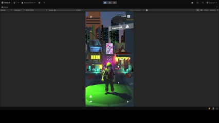
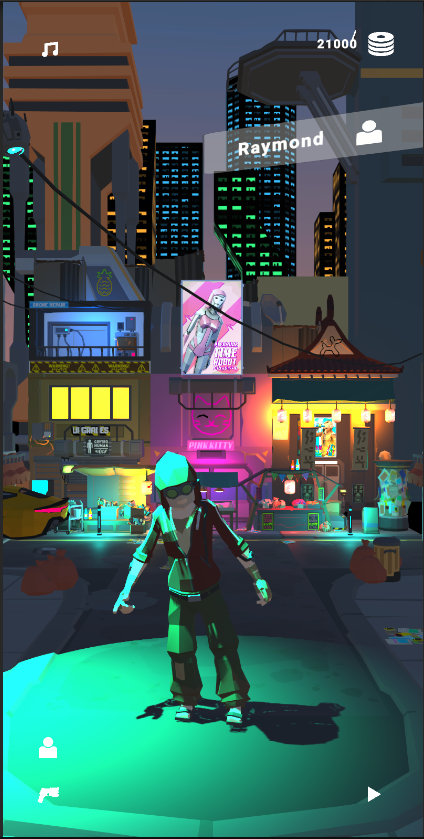
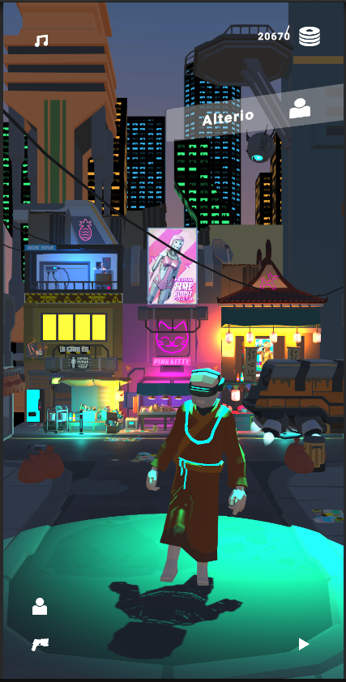
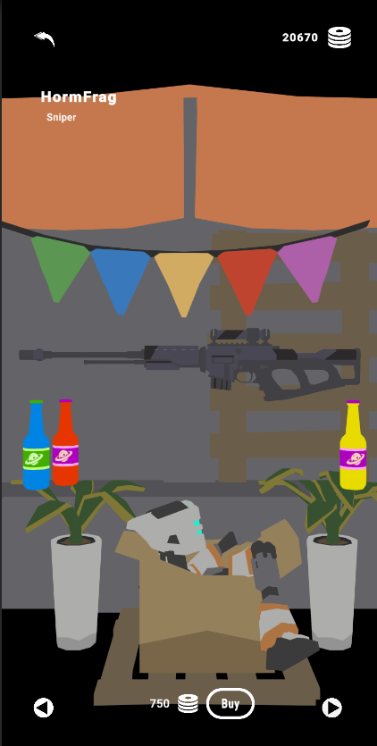

[← cd ~/portfolio](../../README.md)

# `$ cat ~/games/criminal.md`

```yaml
Project          : Criminal
Status           : Foundational Project (SMK)
Context          : Personal Project
Platform         : Mobile (Android)
Engine           : Unity
Language         : C#
Role             : Solo Developer (Gameplay & Systems)
Version Control  : Git
Timeline         : August 2021 - February 2022
```

### Visual Showcase


```yaml
Showcase      : 3D Third-Person Shooter for mobile with touch controls & vehicle/cover mechanics
Highlights    : Component-based architecture, 18+ modular weapons, NavMesh enemy AI & IK system
```

<details>
<summary><b>📸 View Screenshot Gallery (3)</b></summary>
<br>





</details>

---

### Architecture & Gameplay Systems
```yaml
Architecture  : Component-Based Model (Modular Decoupled Systems)
Combat & Guns : Modular GunSystem & BulletSystem supporting 18+ weapons (Rifles, Plasma, Grenades)
AI & World    : NavMesh pathfinding, Waypoint PathList, CoverSystems, Ragdoll & Vehicle physics
Player & IK   : Mobile touch input (ButtonHold), Custom IK (MyIKSystems), Recoil & Camera Shake
Meta Systems  : Character, Gun & Map selection systems with dynamic material/light randomization
```

<details>
<summary><b>📂 Inspect Script Architecture (<code>$ tree Assets/Scripts</code>)</b></summary>

```text
├───Ai System (AiComponens, AiSystems, HealtAi, PathList)
├───Characters (StateRandom)
├───Game System
│   ├───Core & Selection (GameSystem, GamePlaySelected, CharacterSelectSystem, GunSelectSystem, MapSelected)
│   ├───Combat & World (CoverSystems, Drone, HitPivotSystems, NavMeshSystems, SystemsRagdoll, TargetSystem)
│   ├───Vehicle & Physics (CarMoveSystem, WheelsSystem)
│   ├───Components & Health (CharacterComponens, ComponensStatic, ConnectionHealt, ConnectorHealt, GunComponens)
│   └───Input & Visuals (ButtonHold, MaterialOwned, RandomColorLight, RandomMaterial)
├───Gun System (BulletSystem, GunSystem, Recoil)
├───Guns
│   ├───Grenades (GrenadeBall01, GrenadeHE01, GrenadeStun01)
│   ├───Pistols & SMGs (MachinePistolGen1, MachinePistolGen2, Pistol01, Revolver01, SMG01)
│   ├───Rifles & Snipers (RifleBase01, RifleLaser01, RiflePlasma01-03, RifleSmall01, Sniper01, SniperPlasma02)
│   └───Special (ShotgunPlasma01, SyringeGun01)
├───Player (HealtPlayer, MyIKSystems, PlayerController, PlayerMovement, TestShake)
└───Ui (UiSystem)
```

</details>

---

### Technical Challenges & Solutions
```yaml
Challenge     : Scaling 18+ distinct weapon behaviors, vehicle controls, and AI on mobile hardware
Solution      : Built a Component-Based architecture separating GunSystem, BulletSystem, and AI modules
Result        : Reusable weapon/character components with responsive mobile touch & IK aiming
```

---

### Links & Media
<pre>
Full Video     : <a href="https://youtu.be/LINK_VIDEO_CRIMINAL">https://youtu.be/LINK_VIDEO_CRIMINAL</a>
Playable Build : -
</pre>

<br>

[← cd ~/portfolio](../../README.md)
