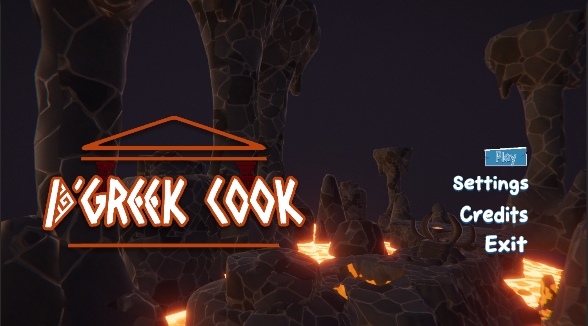
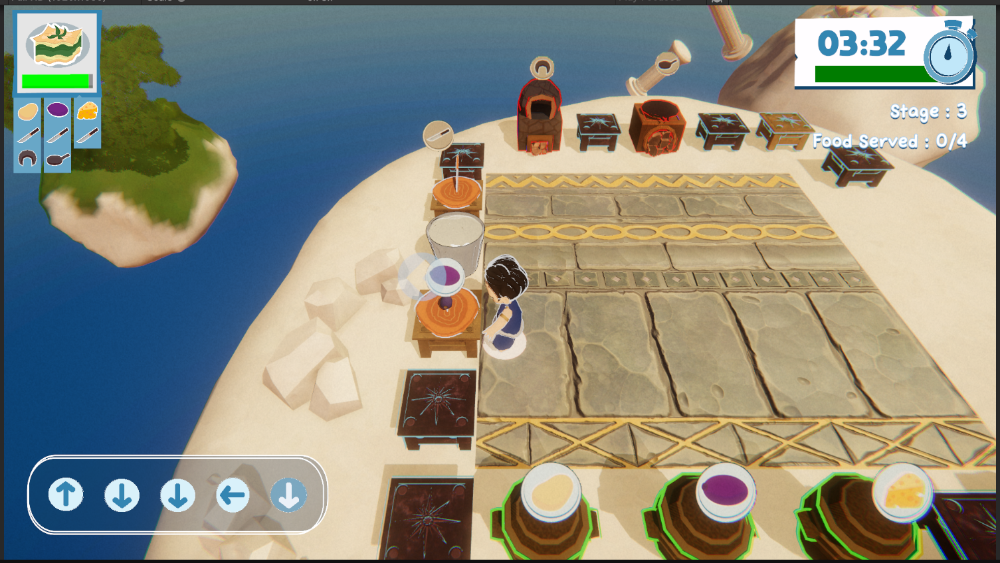
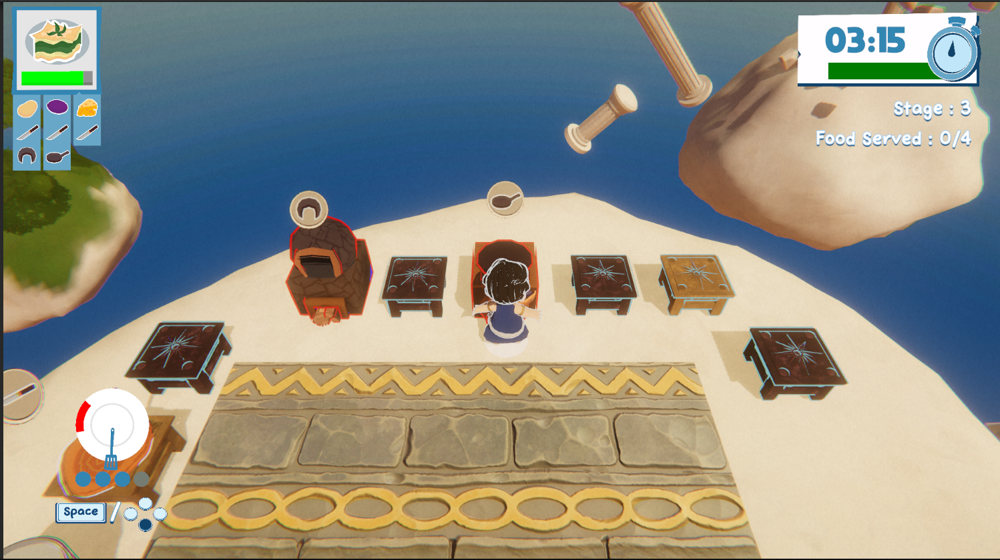

[← cd ~/portfolio](../README.md)

# `$ cat ~/games/dgreek-cook.md`

```yaml
Project          : Dgreek Cook
Status           : Prototype (Unity Rebuild)
Context          : Indie Team (@AegisStudio)
Platform         : PC (Windows)
Engine           : Unity (Rebuilt from Unreal Engine)
Language         : C#
Role             : Gameplay Systems Developer
Version Control  : Git
Timeline         : September 2025 – December 2025 (June 2025 - July 2025 (unreal timeline))
```

### Visual Showcase


```yaml
Showcase      : Fast-paced cooperative cooking & skill-check game rebuilt in Unity
Highlights    : Ground-up modular framework (Singleton + State), scalable local co-op PlayerState, Object Pooling
```

<details>
<summary><b>📸 View Screenshot Gallery (3)</b></summary>
<br>





</details>

---

### Architecture & Gameplay Systems
```yaml
Core Patterns : Custom Modular Framework using Singleton, State Pattern & Interface Decoupling
Game & Player : Hierarchical GameState (Lobby, Gameplay, Pause, Finish) & scalable PlayerState for Local Co-op
Kitchen Loop  : Interface-driven stations (Stove, Oven, Cut, Table, Altar, Dish) & Trigger interaction system
Managers      : Centralized OrderManager, StageManager, KitchenSetManager, ObstacleManager & ObjectPoolManager
```

<details>
<summary><b>📂 Inspect Script Architecture (<code>$ tree Assets/Scripts</code>)</b></summary>

```text
├───core
├───single
│   │   HorizontalLayout3D.cs, UISelector.cs
│   ├───camera (camerainterface, PlayerCamera)
│   ├───kitchen (Altar, Cut, Dish, Ingredients, Oven, Stove, Table Systems, kitcheninterface)
│   ├───player
│   │   ├───Core & Animation (PlayerInteract, playerinterface, AnimationBridge, AnimationHandler)
│   │   └───State Machine (PlayerState, playerstateinterface -> Movement, Combo, SkillCheck, Stun)
│   └───trigger (TriggerBase -> Altar, Bin, Cut, Dish, Fall, Ingredients, Kitchen, Oven, Stove, Table)
├───singleton
│   │   singleton.cs
│   └───Managers (Audio, Cheat, Component, Game, Input, KitchenSet, Level, ObjectPool, Obstacle, Order, Platform, Stage, Ui)
└───state
    │   GameState.cs, stateinterface.cs
    └───sub-state (MainMenu, Loby, Gameplay, Pause, GameOver, FinishGame)
```

</details>

---

### Technical Challenges & Solutions
```yaml
Challenge     : Migrating an Unreal Engine game jam entry to Unity while supporting scalable local co-op
Solution      : Architected a modular C# framework from scratch with decoupled PlayerState & Kitchen interfaces
Result        : Improved runtime performance, eliminated tight coupling, and streamlined multi-player state handling
```

---

### Links & Media
<pre>
Full Video     : <a href="https://youtu.be/LINK_VIDEO_DGREEK_COOK">https://youtu.be/LINK_VIDEO_DGREEK_COOK</a>
Playable Build : -
</pre>

<br>

[← cd ~/portfolio](../README.md)
