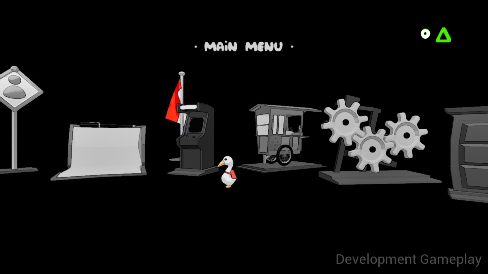
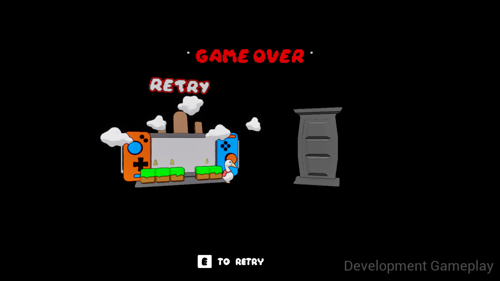
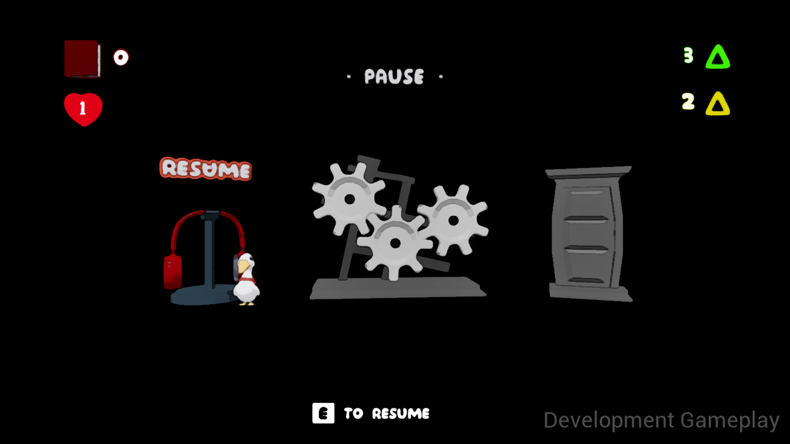
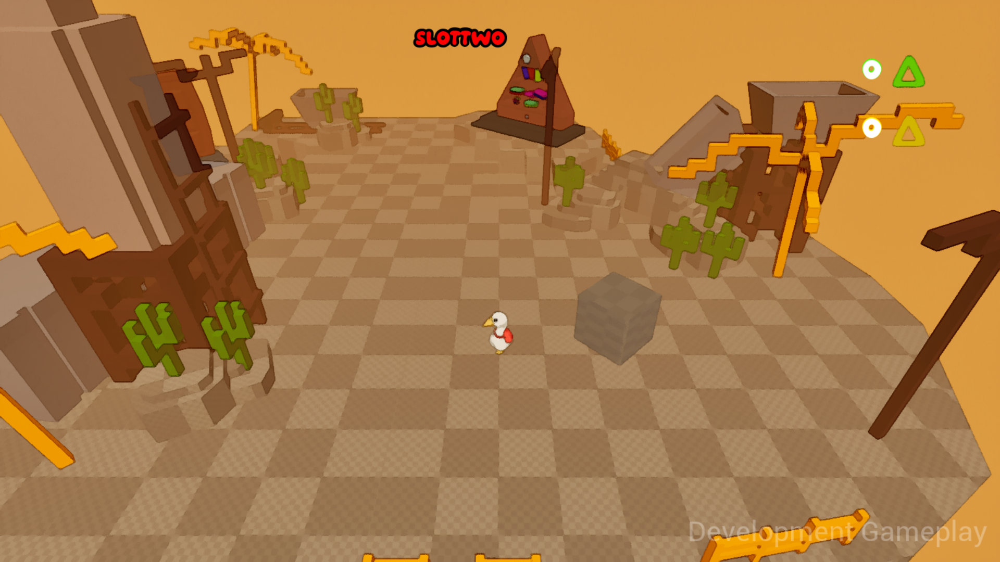

[← cd ~/portfolio](../../README.md)

# `$ cat ~/games/duck.md`

```yaml
Project          : Duck
Status           : Foundational Project
Context          : Personal Project
Platform         : PC (Windows)
Engine           : Unreal Engine
Language         : Blueprint (Visual Scripting)
Role             : Solo Developer (Gameplay, AI & 3D Assets)
Version Control  : Git
Timeline         : December 2023 - March 2024
```

### Visual Showcase


```yaml
Showcase      : 3D Platformer built entirely in Unreal Engine Blueprints with custom 3D assets
Highlights    : Unreal Gameplay Framework, Behavior Tree enemy AI, custom 3D modeling & animations
```

<details>
<summary><b>📸 View Screenshot Gallery (4)</b></summary>
<br>






</details>

---

### Architecture & Gameplay Systems
```yaml
Architecture  : Unreal Gameplay Framework (GameMode, GameInstance, PlayerController, Character)
Logic & Code  : 100% Blueprint Visual Scripting (Event Graphs, Blueprint Interfaces, Macro Libraries)
Enemy AI      : Unreal AI System using Behavior Trees, Blackboard, AIController & NavMeshBounds
World & Art   : Custom 3D environment/character modeling, platforming obstacles & interactive triggers
```

<details>
<summary><b>📂 Inspect Blueprint Architecture (<code>$ tree Content/Blueprints</code>)</b></summary>

```text
├───Core (BP_DuckGameMode, BP_DuckGameInstance, BP_DuckPlayerController)
├───Player (BP_DuckCharacter, ABP_DuckAnimBlueprint)
├───AI
│   ├───Controllers (AIC_EnemyController)
│   └───BehaviorTree (BT_EnemyAI, BB_EnemyBlackboard, BTT_Tasks, BTS_Services)
├───Gameplay
│   ├───Platforms (BP_MovingPlatform, BP_RotatingGear, BP_BouncePad)
│   └───Interactables (BP_Checkpoint, BP_Collectible, BP_HazardTrigger)
└───UI (WBP_MainMenu, WBP_PlayerHUD, WBP_PauseMenu)
```

</details>

---

### Technical Challenges & Solutions
```yaml
Challenge     : Learning Unreal Engine workflows, 3D asset creation, and AI logic from scratch as a solo dev
Solution      : Leveraged Unreal Gameplay Framework with modular Blueprint Interfaces and Behavior Trees
Result        : Delivered a complete 3D platformer with responsive controls, custom assets, and dynamic AI
```

---

### Links & Media
<pre>
Full Video     : <a href="https://youtu.be/LINK_VIDEO_DUCK">https://youtu.be/LINK_VIDEO_DUCK</a>
Playable Build : -
</pre>

<br>

[← cd ~/portfolio](../../README.md)
