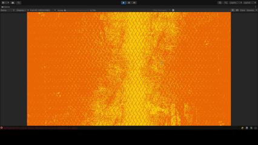
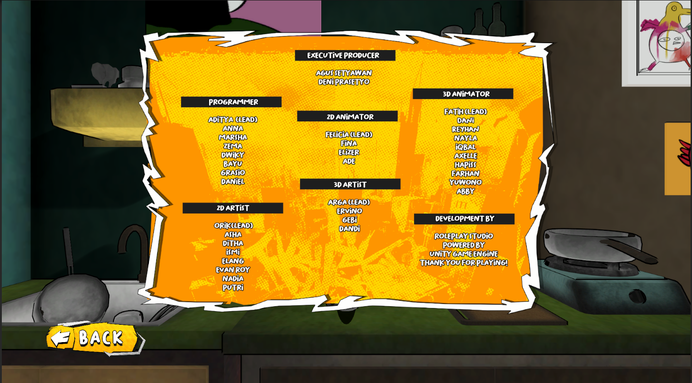

[← cd ~/portfolio](../README.md)

# `$ cat ~/games/indekos.md`

```yaml
Project          : Indekos
Status           : Commercial Rebuild
Context          : Professional Work (@RoleplayStudio)
Platform         : PC (Windows)
Engine           : Unity (Adventure Creator Integration)
Language         : C#
Role             : [Lead] Gameplay Systems Developer
Version Control  : Git
Timeline         : April 2024 – November 2024
```

### Visual Showcase


```yaml
Showcase      : Narrative life-sim & adventure game re-architected for scalable quest & daily-life loops
Highlights    : Scene-per-location architecture, dynamic prefab quest spawner, custom Singleton/State framework
```

<details>
<summary><b>📸 View Screenshot Gallery (1)</b></summary>
<br>



</details>

---

### Architecture & Gameplay Systems
```yaml
Core Patterns : Custom Singleton & Unified State Manager (16+ GameStates) with InputBridge & Encryption
World & Quest : Re-architected from scene-per-quest to scene-per-location + dynamic prefab quest spawning
Plugin Bridge : Seamless C# integration with Adventure Creator, NPC crowds, Day/Time cycle & SaveLoadManager
Mini-Games    : Rhythm Guitar, Mingsut, Tarot reading, Study/Minimarket loops & custom Editor tooling
```

<details>
<summary><b>📂 Inspect Script Architecture (<code>$ tree Assets/Scripts</code>)</b></summary>

```text
├───core
│   ├───Managers (Audio, Character, Cheat, ChitChat, Component, DateTime, Game, Input, Level, Quest, SaveLoad, Story, Study, UI)
│   ├───additional (Encryption, TriggerManager, Triggers: Action, DialogueNPC, Door, Input, Sleep)
│   └───pattern
│       │   singleton.cs
│       ├───input (InputBridge)
│       └───state (GameState, stateinterface -> Gameplay, Cutscene, Guitar, Mingsut, Tarot, Study, Minimarket, NextDay, Pause)
├───editor (ComponentSaveListWindow, GranularApplyWindow, HierarchyHighlighter, PlayModeSave)
└───system
    ├───audio & loading (BGM, SFX, LoadingController)
    ├───MiniGame (Gitar, Guitar Final, Mingsut)
    ├───NPC & World (Crowd

```

</details>

<br>

[← cd ~/portfolio](../README.md)
