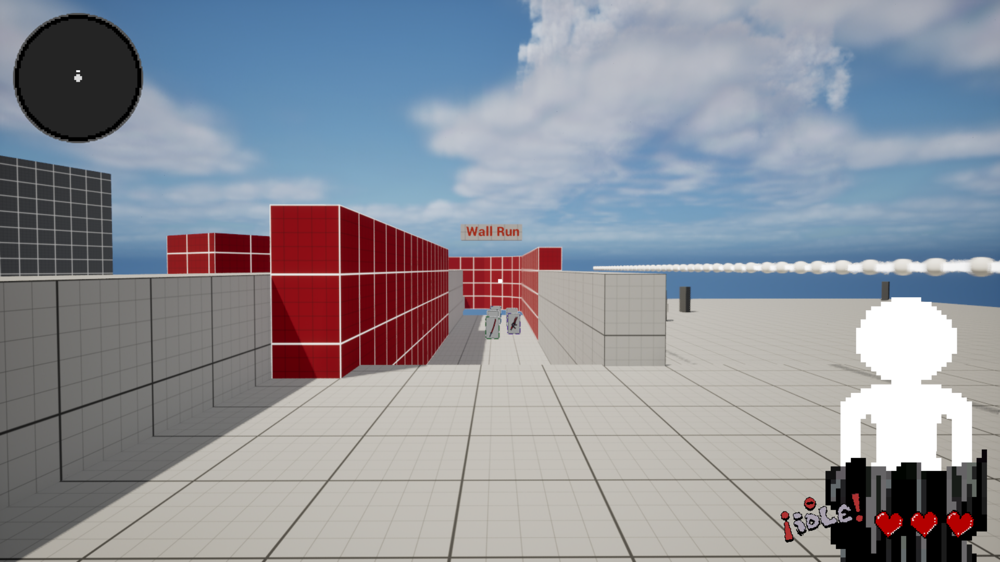
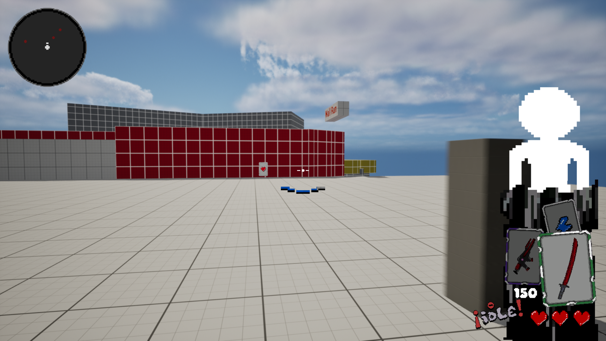
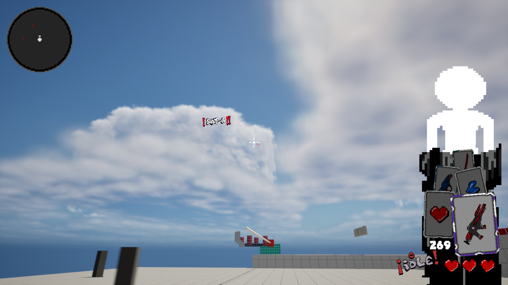

[← cd ~/portfolio](../README.md)

# `$ cat ~/games/neo-strife.md`

```yaml
Project          : Neo Strife
Status           : Prototype / Technical Challenge
Context          : Personal Project
Platform         : PC (Windows)
Engine           : Unreal Engine
Language         : C++ (Zero Blueprints)
Role             : Solo Developer (Gameplay, Systems & 2D Pixel Art)
Version Control  : Git
Timeline         : January 2025 - February 2025
```

### Visual Showcase


```yaml
Showcase      : Fast-paced FPS built 100% in C++ without Blueprints in Unreal Engine
Highlights    : Pure C++ Gameplay Framework, Card & CC Damage system, Interface-driven architecture
```

<details>
<summary><b>📸 View Screenshot Gallery (3)</b></summary>
<br>





</details>

---

### Architecture & Gameplay Systems
```yaml
Core Framework : 100% C++ Unreal Gameplay Framework (GameMode, PlayerController, Character, HUD)
Combat & Cards : Card & DataCard system, custom Projectiles, and 5+ Crowd-Control DamageTypes
Decoupling     : 6 Custom C++ UInterfaces (Character, Controlled, Damage, GameMode, HUD, Projectile)
Polish & Art   : C++ CameraShake classes (Attack, Damaged, Deflect), Function Libraries & 2D Pixel Art
```

<details>
<summary><b>📂 Inspect Script Architecture (<code>$ tree Source/NeoStrife</code>)</b></summary>

```text
├───Core (NeoStrifeGameMode, NeoStrifePlayerController, NeoStrifeCharacter, NeoStrifeHUD, Card, DataCard, Projectile)
├───Camera (CameraShakeAttack, CameraShakeDamaged, CameraShakeDeflect)
├───Components (CharacterComponent)
├───Damage (BaseDamageType -> DisableCardCC, NoneCC, SlowCC, StuntCC)
├───Interface (InterfaceCharacter, InterfaceControlled, InterfaceDamage, InterfaceGameMode, InterfaceHUD, InterfaceProjectile)
└───Library (LibraryCard, LibraryFunction)
```

</details>

---

### Technical Challenges & Solutions
```yaml
Challenge     : Implementing full FPS gameplay, UI/HUD, and card mechanics in Unreal Engine without Blueprints
Solution      : Engineered pure C++ GameMode, HUD, UInterfaces, and custom UDamageType subclasses from scratch
Result        : Deep mastery of Unreal's C++ Gameplay Framework, memory/header structure, and decoupled systems
```

---

### Links & Media
<pre>
Full Video     : <a href="https://youtu.be/LINK_VIDEO_NEO_STRIFE">https://youtu.be/LINK_VIDEO_NEO_STRIFE</a>
Playable Build : -
</pre>

<br>

[← cd ~/portfolio](../README.md)
