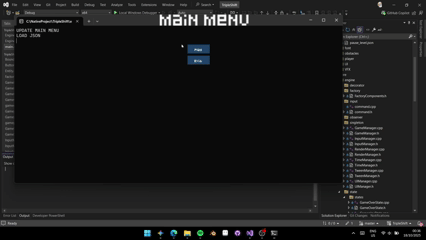
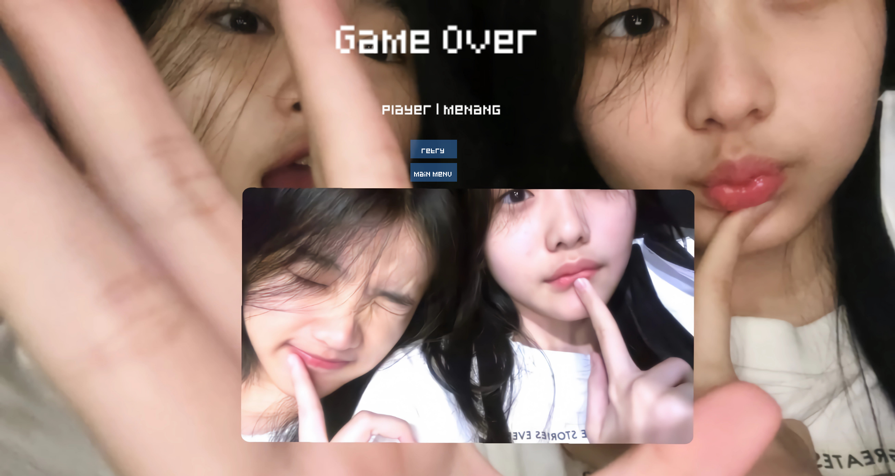
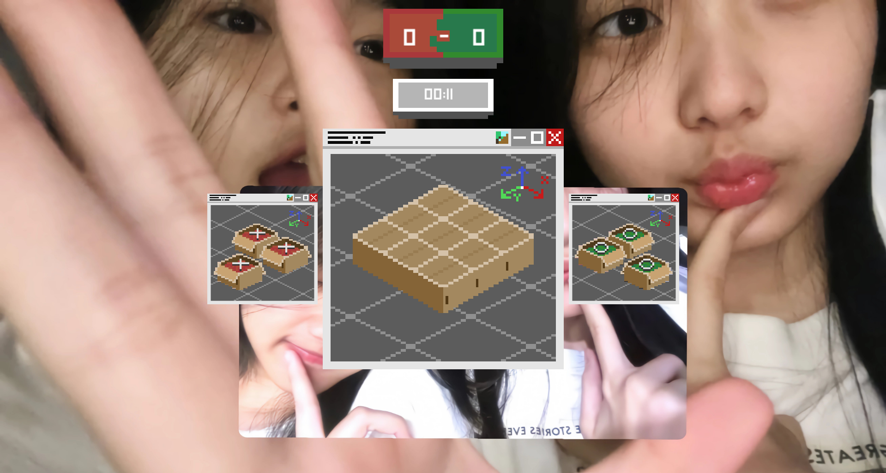

[← cd ~/portfolio](../../README.md)

# `$ cat ~/games/triple-shift.md`

```yaml
Project          : Triple Shift
Status           : Academic Capstone
Context          : 2-Person Team Project
Platform         : PC (Windows)
Engine           : Custom Engine (OpenGL | GLM | GLFW | ImGui)
Language         : C++ & JSON
Role             : Engine Programmer (Sole Programmer)
Version Control  : Git
Timeline         : June 2025 - October 2025
```

### Visual Showcase


```yaml
Showcase      : Custom 2D C++ game engine built from scratch around Entity Component System (ECS)
Highlights    : OpenGL graphics pipeline (Shaders, VAO/VBO/EBO), ECS architecture, JSON data-driven levels
```

<details>
<summary><b>📸 View Screenshot Gallery (3)</b></summary>
<br>





</details>

---

### Architecture & Gameplay Systems
```yaml
Core Engine   : Custom C++ Engine using Entity Component System (ECS) + Singleton, State & Factory patterns
Graphics      : Low-level OpenGL pipeline (ShaderProgram, VAO, VBO, EBO, Texture) & ImGui debugging UI
Gameplay      : GLM collision math (BoundingBox, RayLine), TweenTransform system & TurnTimer logic
Data-Driven   : JSON level serialization (mainmenu, gameplay, pause, gameover) via nlohmann/json
```

<details>
<summary><b>📂 Inspect Engine & Game Architecture (<code>$ tree Source</code>)</b></summary>

```text
├───core
│   │   Engine.cpp / .h
│   ├───engine
│   │   ├───factory (FactoryComponents)
│   │   ├───input (command)
│   │   ├───singleton (Game, Input, Render, Time, Tween, UI Managers)
│   │   └───state (GameState -> MainMenu, Gameplay, Pause, GameOver)
│   ├───graphics_pipeline (VAO, VBO, EBO, ShaderProgram, Texture, stb, shaders/object.vert & .frag)
│   └───patterns (decorator, factory, observer, singleton, state)
├───game
│   ├───entity
│   │   ├───components (BoundingBox, Button, Sprite, TextBlock, Transform)
│   │   └───systems (SpriteSystem)
│   ├───level (Level.cpp / .h -> JSON loader)
│   ├───logic (PlayerController)
│   ├───ray (RayLine)
│   ├───time (TurnTimer)
│   └───tween (TweenTransform, TweenDatas, InterfaceTween)
└───assets
    ├───data_levels (mainmenu_level.json, gameplay_level.json, pause_level.json, gameover_level.json)
    └───sprites & UI (board, obstacles, player, UI, VFX, font)
```

</details>

---

### Technical Challenges & Solutions
```yaml
Challenge     : Building a high-performance game engine from scratch in C++ without relying on commercial engines
Solution      : Engineered a custom OpenGL rendering pipeline, ECS data layout, and JSON level loader
Result        : Decoupled game logic from rendering, achieved smooth frame pacing, and enabled data-driven levels
```

---

### Links & Media
<pre>
Full Video     : <a href="https://youtu.be/LINK_VIDEO_TRIPLE_SHIFT">https://youtu.be/LINK_VIDEO_TRIPLE_SHIFT</a>
Playable Build : -
</pre>

<br>

[← cd ~/portfolio](../../README.md)
